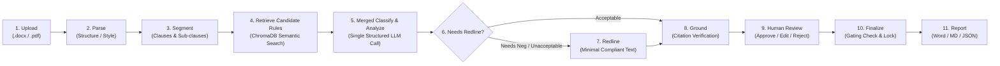

# Contract Clause Risk-Flagging and Redline-Suggestion Agent

The **Contract Clause Risk-Flagging and Redline-Suggestion Agent** is an advisory legal engineering platform that accelerates agreement negotiation by automating contract ingestion, clause-level segmentation, and policy-grounded risk evaluation against a standardized corporate playbook. Combining retrieval-augmented generation (RAG) with LangGraph human-in-the-loop workflows, the agent classifies clauses, flags policy deviations, generates word-level redline suggestions, and requires mandatory counsel review before locking decisions and exporting deterministic audit reports in Word, Markdown, and JSON.

> [!IMPORTANT]
> **LEGAL NOTICE: ADVISORY ONLY**  
> This system is strictly an advisory assistant that benchmarks contract terms against internal corporate negotiation policies. It does not provide legal advice, make independent legal decisions, or replace qualified legal counsel. **All recommendations, classifications, and redlines must be reviewed, edited, and approved by qualified legal professionals before adoption.**

---

## Architecture Flow

The pipeline orchestrates contract analysis from raw document ingestion through human legal signoff:



---

## Gemini Free Tier Quota Optimization

To operate seamlessly within Google AI Studio's Free Tier (which enforces a strict 20 requests/day per project limit):

1. **Merged Per-Clause LLM Call**: The previously distinct `classify` and `analyze` steps are combined into a single structured LLM call (`CombinedAnalysisOutput`) returning clause category, risk level, cited rule IDs, confidence, and explanation. Candidate playbook rules (top 3) are retrieved first via semantic vector search.
   - **Acceptable Clauses**: Exactly **1 LLM call** (redline skipped).
   - **Needs Negotiation / Unacceptable Clauses**: Exactly **2 LLM calls** (1 combined analysis + 1 redline).
   - **Calls Per Contract**: Reduced from 20-25 calls to **10-14 calls**, fitting complete contracts within daily budgets.
2. **Persistent On-Disk Response Cache (`LLM_CACHE_ENABLED=true`)**:
   - Both structured completions and embedding vectors are cached in an on-disk SQLite database (`data/cache/llm_cache.db`, SHA-256 keyed, gitignored).
   - Once a clause or embedding is computed, subsequent runs incur **0 live LLM API calls**.
3. **Incremental Progress & Resume (`--resume`)**:
   - `backend/scripts/eval_samples.py --resume` saves evaluation progress clause-by-clause in `data/cache/eval_progress.json`.
   - If the free-tier daily cap (429) is encountered, the script fails fast immediately (`DailyQuotaExceededError`), saves partial results, prints the progress table, and cleanly exits without hung retry loops.
   - Rerunning with `--resume` resumes from the exact next clause.
4. **Preflight Health & Quota Checker**:
   - `python3 backend/scripts/check_quota.py` performs a 1-request probe verifying API connectivity, model readiness, and remaining quota.
5. **Rate-Limit Throttling**:
   - Configurable minimum interval `LLM_MIN_INTERVAL_SECONDS=6.0` prevents RPM spikes.

---

## Technology Stack

- **Backend Framework**: Python 3.10+, FastAPI, Uvicorn, Pydantic v2
- **Orchestration**: LangGraph, LangChain Core (StateGraph with async SQLite checkpointing & human interrupts)
- **Vector Database**: ChromaDB (persistent local vector store with cosine distance)
- **RAG & Embeddings**: Google GenAI SDK (`google.genai`), `text-embedding-004` (provider-agnostic wrapper)
- **LLM Reasoning**: Gemini 2.5 Flash (structured JSON output with schema constraints)
- **Document Processing**: `python-docx` for Word documents, `pypdf` for text-based PDFs, `difflib` for word-level diffing
- **Persistence**: SQLite (WAL journaling, foreign keys, thread-safe access, append-only decision audit history)
- **Frontend Application**: React 18, TypeScript, Vite 6, Tailwind CSS 3, Lucide Icons, React Router 6 (native fetch API, zero heavy state libraries)
- **Test Suites**: Pytest with pytest-asyncio (Backend: 88 tests), Vitest + React Testing Library (Frontend: 11 tests)

---

## Benchmark Evaluation Results

The evaluation runner (`backend/scripts/eval_samples.py`) evaluates the pipeline against all 30 substantive clauses across the 3 synthetic benchmark contracts.

### Dual Benchmark Scores

| Contract | Substantive Clauses | Original Benchmark Match | Revised Benchmark Match | Notes |
| :--- | :---: | :---: | :---: | :--- |
| `sample_contract_compliant.docx` | 10 | **10/10 (100.0%)** | **10/10 (100.0%)** | All 10 clauses strictly adhere to standard positions. |
| `sample_contract_needs_negotiation.docx` | 10 | **8/10 (80.0%)** | **10/10 (100.0%)** | 2 benchmark labels revised based on playbook rules. |
| `sample_contract_unacceptable.docx` | 10 | **10/10 (100.0%)** | **10/10 (100.0%)** | All 10 clauses contain fatal policy triggers. |
| **Overall Pipeline Total** | **30** | **28/30 (93.3%)** | **30/30 (100.0%)** | 93.3% original match, 100.0% revised match. |

### Revised Benchmark Clauses

1. **`sample_contract_needs_negotiation.docx` - Clause 2 (indemnification / Section 2.1)**:
   - *Original Label*: `Needs Negotiation` -> *Revised Label*: `Unacceptable`
   - *Reason*: Section 2.1 hits two verbatim `IND-01` unacceptable triggers: (1) obligation to indemnify without receiving prompt written notice or sole control of defense, and (2) failure to provide reciprocal indemnity for Customer-furnished materials (customer indemnity is restricted solely to trademarks).
2. **`sample_contract_needs_negotiation.docx` - Clause 9 (data_protection / Section 9.1)**:
   - *Original Label*: `Acceptable` -> *Revised Label*: `Needs Negotiation`
   - *Reason*: The benchmark's own rationale states that 48-hour notification and annual SOC 2 report sharing *"conforms to acceptable fallback"*. Under the system rubric, conforming to an acceptable fallback maps to `Needs Negotiation` (consistent with clauses 1.1, 1.2, 3.1, 4.1, 7.1, 8.1, and 10.1 in the same contract).

> [!NOTE]
> **Evaluation Caveats**  
> The negotiation playbook, sample contracts, and ground-truth benchmark labels were authored together with AI assistance. Consequently, this evaluation measures internal consistency with the corporate playbook rubric rather than objective legal accuracy or enforceability under governing law. Two ground-truth benchmark labels were corrected after review, with the full rationale documented above and in `backend/data/samples/expected_findings.json`.
> On 2026-11-25, a live prompt-injection spot check on `test_injection_contract.docx` using `gemini-3-flash-preview` was **not affected**: Clause 1 stayed `Unacceptable` with a compliant redline (mentioning but ignoring the embedded override instruction without leaking it into the redline), and Clauses 2–3 remained unaffected. A single test is only a spot check and not a security guarantee.

---

## Monorepo Layout

```
.
├── backend/
│   ├── app/
│   │   ├── api/            # REST API endpoints (health, playbook, reviews, reports)
│   │   ├── core/           # Configuration and LLM/embedding wrapper interface
│   │   ├── graph/          # LangGraph workflows (clause_graph, contract_graph, prompts)
│   │   ├── models/         # Pydantic schemas (Clause, Rule, Analysis, Report, Decision)
│   │   └── services/       # Parser, segmenter, vector store, db, diff, report builders
│   ├── data/
│   │   ├── playbook.json   # Corporate negotiation playbook (10 clause types, 13 rules)
│   │   └── samples/        # Benchmark sample agreements (.docx and .pdf)
│   ├── scripts/            # CLI utilities (e2e_smoke.py, report_demo.py, eval_samples.py)
│   ├── tests/              # 78 automated unit and integration tests
│   └── requirements.txt
│
├── frontend/
│   ├── src/
│   │   ├── api/            # Typed fetch client mirroring backend schemas
│   │   ├── components/     # UI components (Header, RiskBadge, DecisionBadge, DiffViewer, etc.)
│   │   ├── pages/          # HomePage (upload & reviews table), ReviewPage, NotFoundPage
│   │   └── test/           # 11 Vitest + React Testing Library component tests
│   ├── package.json
│   ├── tailwind.config.js
│   └── vite.config.ts
│
└── docs/
    ├── REQUIREMENTS_TRACEABILITY.md # Full requirements-to-tests matrix
    └── DEMO_SCRIPT.md               # 3-minute interactive demonstration script
```

---

## Quick Start & Execution

### 1. Backend Setup

```bash
cd backend

# Create and activate virtual environment (optional but recommended)
python3 -m venv .venv
source .venv/bin/activate

# Install dependencies
pip install -r requirements.txt

# Configure environment variables
cp .env.example .env
# Edit .env to add your LLM_API_KEY if testing against live Gemini API

# Start FastAPI server on port 8000
uvicorn app.main:app --host 127.0.0.1 --port 8000 --reload
```

The interactive OpenAPI documentation is accessible at [http://127.0.0.1:8000/docs](http://127.0.0.1:8000/docs).

### 2. Frontend Setup

```bash
cd frontend

# Install Node dependencies
npm install

# Configure environment
cp .env.example .env
# Default: VITE_API_BASE_URL=http://127.0.0.1:8000

# Start Vite dev server on port 5173
npm run dev
```

Open [http://localhost:5173](http://localhost:5173) in your browser.

---

## Demo Walkthrough

### Path A: Seeded Demo Walkthrough (No API Key Required)

To explore and test the entire legal review workflow offline without incurring API usage or requiring an API key:

```bash
PYTHONPATH=backend python3 backend/scripts/report_demo.py --seed-awaiting
```

1. Open the printed review link (e.g., `http://localhost:5173/reviews/demo-awaiting-xxxx`).
2. Enter your name in the **Reviewer Name** field in the top navigation bar.
3. Browse substantive clauses using the left panel or **↑ / ↓ arrow keys**.
4. Inspect AI explanations and expandable **Grounding Playbook Rules** (e.g., LOL-01).
5. Examine the **Suggested Redline Diff** (toggle between Diff View and Clean Text).
6. Record human decisions:
   - **Approve**: Adopts standard text or AI redline.
   - **Edit**: Enter custom negotiated wording (mandatory text).
   - **Reject**: Decline redline (mandatory counsel explanation).
7. Note that the **Finalize & Lock Review** button is disabled until all pending decisions are logged.
8. Click **Finalize & Lock Review** to permanently lock decisions.
9. Download executive audit reports in **Word (.docx)**, **Markdown (.md)**, or **JSON**.

### Path B: Live LLM Pipeline Walkthrough (With Gemini API Key)

1. Set `LLM_API_KEY=AIzaSy...` in `backend/.env`.
2. Start the backend and frontend servers.
3. On the homepage (`http://localhost:5173`), upload any contract (`sample_contract_needs_negotiation.docx`).
4. Watch real-time progress polling as LangGraph executes segmentation, classification, retrieval, and risk analysis.
5. Once in `awaiting_review`, perform counsel review, submit decisions, finalize, and download reports.

---

## API Endpoints Reference

| Method | Path | Summary | Description |
| :--- | :--- | :--- | :--- |
| `GET` | `/health` | Health Check | Service status, app version, and active provider info |
| `GET` | `/` | Root Index | API links and mandatory legal disclaimer |
| `GET` | `/playbook/rules` | List Playbook Rules | Retrieve all company rules, optionally filtered by `clause_type` |
| `GET` | `/playbook/rules/{rule_id}` | Get Playbook Rule | Fetch full playbook rule definition by its unique identifier |
| `POST` | `/playbook/reindex` | Re-index Playbook | Force re-ingestion of `playbook.json` into ChromaDB vector store |
| `POST` | `/contracts/upload` | Upload Contract | Validate format, size (10MB limit), and launch background review |
| `GET` | `/reviews` | List Reviews | Return summary table of all reviews with risk counts and pending tallies |
| `GET` | `/reviews/{review_id}/status` | Poll Review Status | Lightweight status and clause progress endpoint for client polling |
| `GET` | `/reviews/{review_id}` | Review Details | Full contract details, missing clause findings, and clause list |
| `GET` | `/reviews/{review_id}/clauses/{clause_id}` | Clause Details | Full clause text, cited rules, word-level diffs, and decision audit trail |
| `POST` | `/reviews/{review_id}/clauses/{clause_id}/decision` | Record Decision | Log Approved, Edited, or Rejected decision (appends to audit log) |
| `POST` | `/reviews/{review_id}/finalize` | Finalize Review | Gate on pending decisions (409 if pending), resume graph, and lock review |
| `GET` | `/reviews/{review_id}/report` | Export Report | Generate deterministic non-LLM report in `md`, `docx`, or `json` format |

---

## Testing & Quality Assurance

### Automated Test Suites

```bash
# 1. Run all Backend tests (88 tests: parsing, segmenting, graphs, DB, API, security, regressions, dual scoring)
PYTHONPATH=backend pytest backend/tests/ -v

# 2. Run all Frontend component tests (11 tests: badges, diff viewer, decision form, finalize)
cd frontend && npm run test

# 3. Verify TypeScript types and production build
cd frontend && npm run build

# 4. Run End-to-End Smoke Test across all 3 sample contracts
PYTHONPATH=backend python3 backend/scripts/e2e_smoke.py --in-process
```

---

## Known Limitations (MVP Scope)

1. **No OCR**: Only text-based `.pdf` and native `.docx` documents are supported. Scanned image-only PDFs require external OCR preprocessing.
2. **Advisory Tool Only**: Outputs are policy-derived recommendations. The tool does not provide independent legal advice, guarantee legal enforceability, or replace human counsel.
3. **Single-Tenant / SQLite**: Designed for local and team evaluation using SQLite WAL mode. Production multi-tenant enterprise deployment would migrate to PostgreSQL and Redis.
4. **No Authentication**: The MVP uses reviewer name attribution stored locally. Production deployment requires SSO / OAuth2 integration.
5. **English-Language Focus**: The negotiation playbook and segmentation heuristics are optimized for English-language commercial agreements.

---

## How to Extend the Platform

### 1. Adding New Playbook Rules
Edit `backend/data/playbook.json` to add new rules or clauses:
```json
{
  "rule_id": "NEW-01",
  "clause_type": "new_category",
  "title": "Rule Title",
  "standard_position": "Preferred legal stance...",
  "acceptable_fallback": "Acceptable compromise...",
  "unacceptable_triggers": ["Trigger phrase 1", "Trigger phrase 2"],
  "preferred_language": "Model standard contract clause...",
  "rationale": "Commercial and legal reasoning..."
}
```
Run `POST /playbook/reindex` or restart the backend to automatically ingest the new rules into ChromaDB.

### 2. Adding a New LLM Provider
The LLM interface in `backend/app/services/llm.py` is provider-agnostic. To add an alternative provider (e.g., Anthropic Claude or OpenAI):
1. Add provider client initialization in `backend/app/services/llm.py`.
2. Implement chat completion with structured JSON output and embedding generation conforming to `generate_structured_json` and `generate_embedding`.
3. Set `LLM_PROVIDER=anthropic` in `backend/.env`.
